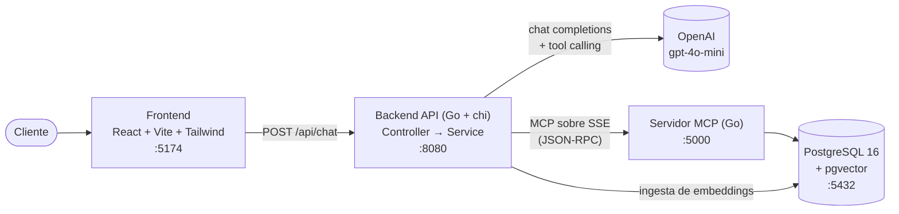
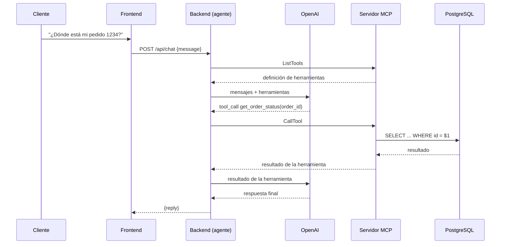

# TechStore Assistant

Plataforma de comercio electrónico de tecnología y domótica con un **asistente conversacional basado en agentes de IA**. El asistente interpreta la intención del cliente y consulta datos reales de la tienda (pedidos, inventario, catálogo, soporte) a través de herramientas expuestas mediante **MCP (Model Context Protocol)**.

## Visión general

Los clientes esperan respuestas inmediatas sobre sus compras y los productos. Un asistente basado únicamente en un modelo de lenguaje genera respuestas sin respaldo, y uno basado solo en documentos no conoce el estado real del negocio. TechStore Assistant resuelve esto separando responsabilidades:

- El **modelo de lenguaje** entiende la solicitud y decide qué herramienta necesita.
- El **servidor MCP** expone esas herramientas como un contrato estándar y desacoplado.
- La **base de datos** es la única fuente de verdad para pedidos, stock y catálogo.

Casos de uso cubiertos:

- Seguimiento de pedidos
- Consulta de disponibilidad y precios
- Búsqueda de productos en el catálogo
- Creación de tickets de soporte técnico

## Arquitectura



### Flujo de una solicitud



## Componentes

| Componente | Tecnología | Responsabilidad |
|---|---|---|
| Frontend | React 19, TypeScript, Vite, Tailwind CSS, Motion | Tienda web y widget de chat |
| Backend API | Go, chi, go-openai, mcp-go | Endpoint de chat y orquestación del agente (cliente MCP) |
| Servidor MCP | Go, mcp-go (transporte SSE) | Herramientas del negocio sobre JSON-RPC |
| Base de datos | PostgreSQL 16, pgvector, pgx | Datos transaccionales y base de conocimiento vectorial |
| Orquestación | Docker Compose | Entorno local de cuatro servicios |

### Herramientas MCP

| Herramienta | Descripción | Tipo |
|---|---|---|
| `get_order_status` | Estado actual de un pedido | Lectura |
| `check_stock` | Disponibilidad de un producto en bodega | Lectura |
| `search_products` | Búsqueda en el catálogo por palabra clave y precio máximo | Lectura |
| `create_support_ticket` | Alta de un ticket de soporte técnico | Escritura |

## Estructura del repositorio

```
.
├── backend/          API REST y orquestación del agente (controller → service → repository)
├── mcp-server/       Servidor MCP y herramientas del negocio
├── frontend/         Aplicación web (React + TypeScript)
├── db/               Esquema y datos iniciales
└── docker-compose.yml
```

## Puesta en marcha

**Requisitos:** Docker, Docker Compose y una API key de OpenAI.

Crear un archivo `.env` en la raíz del proyecto (no se versiona):

```env
OPENAI_API_KEY=<tu-api-key>
DB_HOST=postgres
DB_PORT=5432
DB_USER=<usuario>
DB_PASSWORD=<contraseña>
DB_NAME=tienda_rag
```

Levantar los servicios:

```bash
docker compose up --build
docker compose ps
```

| Servicio | URL |
|---|---|
| Tienda web | http://localhost:5174 |
| API | http://localhost:8080/api/chat |
| Servidor MCP | http://localhost:5000/sse |
| PostgreSQL | localhost:5432 |

Prueba rápida del endpoint:

```bash
curl -s -X POST http://localhost:8080/api/chat \
  -H 'Content-Type: application/json' \
  -d '{"message":"¿Tienen la Cámara SecureCam Pro en stock?"}'
```

## API

### `POST /api/chat`

Solicitud:

```json
{ "message": "¿Cuál es el estado del pedido 1234?" }
```

Respuesta:

```json
{ "reply": "El pedido 1234 está en camino." }
```

## Stack

Go · chi · pgx · mcp-go · go-openai · PostgreSQL 16 · pgvector · React 19 · TypeScript · Vite · Tailwind CSS · Motion · Docker Compose