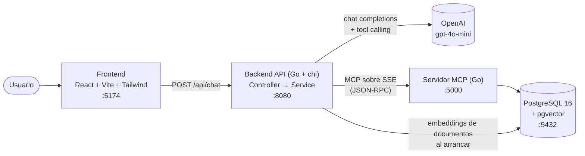
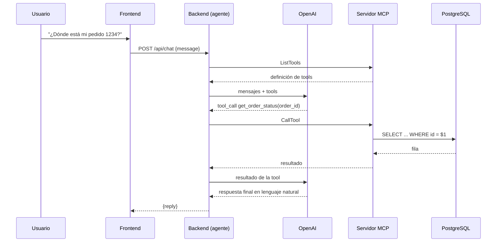

# commerce-rag-mcp · TechStore Assistant

> Tienda de tecnología y domótica con un **agente conversacional** que consulta datos reales mediante **MCP (Model Context Protocol)**.
> Proyecto de aprendizaje: cómo construir, conectar y asegurar un agente de IA dentro de una aplicación web.

---

## ¿Qué problema resuelve?

Un cliente de una tienda online quiere respuestas inmediatas, no esperar en un menú de atención:

- "¿Dónde va mi pedido 1234?"
- "¿Tienen la SecureCam Pro en bodega?"
- "Mi cámara no conecta al WiFi, ¿pueden ayudarme?"
- "¿Cuál es la política de devoluciones?"

Un chatbot basado solo en un LLM **inventa** respuestas. Un chatbot basado solo en documentos **no conoce el stock ni los pedidos reales**. Este proyecto combina ambos mundos: el LLM entiende la intención y **decide qué herramienta usar**; las herramientas consultan la base de datos real.

## ¿Qué implementa?

| Capacidad | Cómo |
|---|---|
| Agente con *function calling* | Bucle en el backend Go: LLM → tool call → resultado → LLM → respuesta |
| Herramientas expuestas por **MCP** | Servidor MCP independiente (Go, transporte SSE) con las tools del negocio |
| Datos reales | PostgreSQL 16 (pedidos, productos, stock, tickets) |
| Base para RAG | `pgvector` + embeddings (`text-embedding-3-small`) de documentos de la tienda |
| Interfaz web | React + Vite + Tailwind con widget de chat flotante |
| Despliegue local | Docker Compose (4 servicios) |

### Tools del servidor MCP

| Tool | Qué hace | Tipo |
|---|---|---|
| `get_order_status` | Consulta el estado de un pedido | Lectura |
| `check_stock` | Disponibilidad de un producto en bodega | Lectura |
| `search_products` | Búsqueda de productos por palabra clave y precio máximo | Lectura |
| `create_support_ticket` | Crea un ticket de soporte técnico | **Escritura** |

## Arquitectura



### Flujo de una consulta (bucle del agente)



## Estructura del repositorio

```
.
├── backend/        API REST en Go (controller → service → repository) y bucle del agente
├── mcp-server/     Servidor MCP en Go con las tools del negocio
├── frontend/       Tienda web + widget de chat (React, TypeScript, Tailwind)
├── db/init.sql     Esquema y datos de ejemplo (incluye pgvector)
├── docker-compose.yml
```

## Puesta en marcha

**Requisitos:** Docker + Docker Compose y una API key de OpenAI.

```bash
# 1) Variables de entorno (archivo .env en la raíz, NO se versiona)
OPENAI_API_KEY=sk-...
DB_HOST=postgres
DB_PORT=5432
DB_USER=admin
DB_PASSWORD=<tu-contraseña>
DB_NAME=tienda_rag

# 2) Levantar todo
docker compose up --build

# 3) Verificar que los 4 servicios estén arriba
docker compose ps
```

| Servicio | URL |
|---|---|
| Tienda web | http://localhost:5174 |
| API | http://localhost:8080/api/chat |
| Servidor MCP | http://localhost:5000/sse |
| PostgreSQL | localhost:5432 |

Prueba rápida:

```bash
curl -s -X POST http://localhost:8080/api/chat \
  -H 'Content-Type: application/json' \
  -d '{"message":"¿Tienen la Cámara SecureCam Pro?"}'
```

## Ramas

| Rama | Propósito |
|---|---|
| `vulnerable` (tag `v0-vulnerable`) | **Línea base intencionalmente insegura**, conservada como el "antes" para comparar y aprender |
| `hardening` | Mejoras: RAG conectado, arquitectura n-tier, autenticación y controles de seguridad |

> ⚠️ **Aviso:** la rama `vulnerable` contiene fallos a propósito (sin autenticación, MCP expuesto, credenciales de ejemplo). **Es solo educativa: no la despliegues.**

## Estado actual de la línea base

Lo que funciona: agente con tool calling, servidor MCP, consulta de pedidos/stock/productos, creación de tickets y UI de chat.

Limitaciones conocidas (detalle en [`FINDINGS.md`](FINDINGS.md)):

- **RAG incompleto:** los embeddings de `tienda_docs` se generan, pero ninguna tool los consulta todavía.
- **Sin autenticación ni propiedad de datos:** cualquiera puede consultar cualquier pedido (control de acceso roto).
- **Servidor MCP sin autenticación** y publicado en el host.
- **Bucle del agente sin límite de iteraciones ni timeout;** sin memoria de conversación.
- Sin *rate limiting*; CORS abierto.

## Hoja de ruta

1. **Base de datos y n-tier:** esquema realista (clientes, categorías, productos, inventario, pedidos, tickets), migraciones versionadas y capas `domain → repository → service → handler` compartidas por la API y el MCP.
2. **RAG como tool del MCP:** `search_knowledge` con búsqueda por similitud (`pgvector`), umbral y *top-k*; textos recuperados tratados como datos no confiables.
3. **Seguridad:** autenticación (JWT), `user_id` inyectado por el backend (nunca decidido por el LLM), MCP en red interna y autenticado, *rate limiting*, límites de entrada, CORS restringido.
4. **Frontend realista:** catálogo desde la API, detalle de producto, carrito, login y chat con Markdown sanitizado.

Cada práctica de seguridad aplicada se registra con trazabilidad (archivo y línea) en `SECURITY_LOG.txt`.

## Stack

Go · chi · pgx · mark3labs/mcp-go · go-openai · PostgreSQL 16 + pgvector · React 19 · TypeScript · Vite · Tailwind CSS · Motion · Docker Compose

## Licencia y uso

Proyecto educativo (prueba de concepto). No es un producto listo para producción.